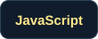
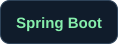
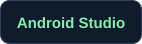
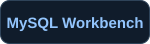
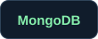

  

  <strong>Ideas claras. Código con intención.</strong> 
  Aprender, construir y mejorar en cada proyecto.

 

## Hola, soy Rubén

Desarrollo aplicaciones **web y móviles** con **Java, Python, Kotlin y JavaScript**. Trabajo con **React, Spring Boot y Node.js**, y con bases de datos **SQL y NoSQL**, combinando lógica, diseño de interfaces y gestión de datos.

Este perfil es mi punto de encuentro entre el aprendizaje y la práctica: un espacio para construir, experimentar y seguir mejorando.

 

## Proyectos

### PitLog · Garaje digital para Android

Aplicación para llevar el mantenimiento de coches y motos. Permite registrar revisiones con fecha, kilometraje y coste, consultar avisos y guardar una foto principal y una galería por vehículo.

Funciona sin conexión. Los datos se guardan en el móvil y se pueden exportar y restaurar mediante una copia de seguridad.

**Tecnologías** · Java, Android WebView, HTML, CSS, JavaScript e IndexedDB.

[Descargar PitLog 1.1 para Android](./assets/PitLog-1.1.apk) · Requiere Android 8.0 o posterior.

 

## Tecnologías

### Lenguajes y tecnologías web

  
  
  
  
  
  
  
  

### Web y backend

  
  
  

### Desarrollo móvil

Aplicaciones Android con **Java, Kotlin y XML**.

  

### Bases de datos SQL y NoSQL

  
  
  
  
  
  

### Herramientas y metodología

  
  
  
  
  
  

 

## En qué me centro

**Desarrollo web** · Interfaces con React, HTML y CSS, y backend con Spring Boot y Node.js.

**Desarrollo móvil** · Aplicaciones Android con Java, Kotlin, XML y Android Studio.

**Datos** · Bases de datos relacionales y NoSQL con Oracle, MySQL, Firebase y MongoDB.

**Organización y documentación** · Scrum, Trello y Jira para organizar el trabajo; UML para modelar y documentar soluciones.

 

  
<strong>Un poco más sobre mi trabajo</strong>

   

  Mis proyectos combinan ejercicios de programación y aplicaciones prácticas. Mantengo mis repositorios personales en privado; aquí comparto una presentación de las tecnologías y áreas con las que trabajo.

 

---

  <strong>Rubén Martín</strong> · <a href="https://github.com/rmartin-11">@rmartin-11</a> 
  Una idea. Un commit. Un paso más.

